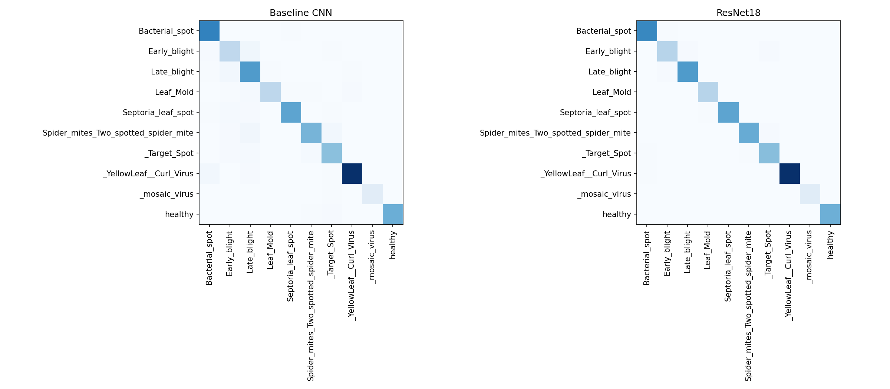
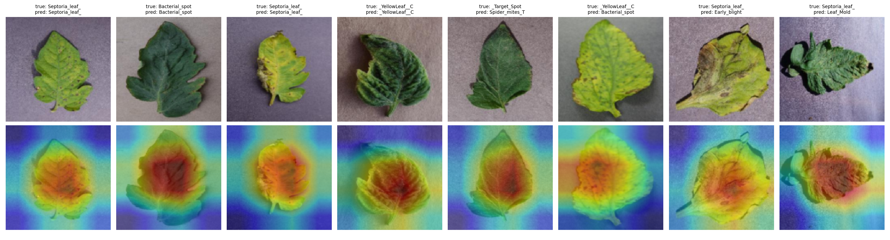

# Tomato Leaf Disease Classification: Transfer Learning vs a From-Scratch CNN, with Robustness Testing

A comparison of a small CNN trained from scratch and a fine-tuned ImageNet-pretrained ResNet18 on 10 tomato leaf classes from PlantVillage. Beyond accuracy, the project looks at per-class errors, Grad-CAM heatmaps and how both models behave under blur, brightness changes and noise.

## Summary

| Model | Test accuracy | Macro F1 |
|---|---|---|
| Small CNN (from scratch) | 0.887 | 0.847 |
| ResNet18 (fine-tuned) | 0.983 | 0.980 |

- Fine-tuning gave a 9.6 point accuracy gain, and the gap was concentrated in a few classes (see Error analysis).
- Under darkening, the baseline predicted Late blight for 86% of test images and fell to 21% accuracy, while ResNet18 kept 89.5%.
- Both models degrade under noise and blur, so high clean accuracy does not mean general robustness.

## Data

- Dataset: PlantVillage (Kaggle: (https://www.kaggle.com/datasets/emmarex/plantdisease)), 10 tomato classes: Bacterial spot, Early blight, Late blight, Leaf mold, Septoria leaf spot, Spider mites, Target spot, Yellow leaf curl virus, Mosaic virus, Healthy.
- Only the tomato classes were used, to keep training fast on a free Colab GPU.
- Stratified 70/15/15 train/validation/test split with a fixed seed (42). The split is saved to a file and reused for every experiment. The test set has 2402 images.
- The dataset zip contained the same folders twice. Only one copy was used so no image appears twice.

## Methods

**Baseline CNN.** Three conv blocks (32, 64, 128 channels) with BatchNorm, ReLU and max pooling, then global average pooling, dropout (0.3) and a linear layer. Adam, learning rate 1e-3, 15 epochs, 128x128 inputs, random horizontal flip, no input normalization.

**ResNet18.** ImageNet-pretrained weights with the final layer replaced for 10 classes. Adam, learning rate 1e-4, 5 epochs, 128x128 inputs, random horizontal flip, ImageNet normalization.

For both models, the checkpoint with the best validation accuracy was used, and the test set was evaluated once after training. Neither model was tuned against test results.

## Results

### Per-class F1

| Class | Baseline CNN | ResNet18 |
|---|---|---|
| Bacterial spot | 0.952 | 0.997 |
| Early blight | 0.459 | 0.953 |
| Late blight | 0.819 | 0.977 |
| Leaf mold | 0.651 | 0.972 |
| Septoria leaf spot | 0.924 | 0.980 |
| Spider mites | 0.907 | 0.982 |
| Target spot | 0.878 | 0.966 |
| Yellow leaf curl virus | 0.946 | 0.997 |
| Mosaic virus | 0.949 | 0.991 |
| Healthy | 0.989 | 0.990 |

### Error analysis (baseline)

The baseline's weakness is concentrated in a few classes. Recall for Early blight is 0.300 (ResNet18: 0.940) and for Leaf mold 0.483 (ResNet18: 0.958). The most common baseline mistakes:

| True class | Predicted as | Count |
|---|---|---|
| Early blight | Late blight | 64 |
| Leaf mold | Late blight | 24 |
| Early blight | Yellow leaf curl virus | 21 |
| Leaf mold | Septoria leaf spot | 18 |
| Leaf mold | Spider mites | 17 |

The baseline also over-predicts Late blight (precision 0.705, recall 0.976). Early blight and Late blight both show brown lesions, which may explain the confusion, but this was not tested.

### Robustness

Perturbations were applied to the test images only, at one severity each: Gaussian blur (radius 2), brightness x0.5 and x1.5, Gaussian noise (sigma 25 on a 0-255 scale), and "center only" (the outer 20% on each side replaced with grey).

| Test | Baseline CNN | ResNet18 |
|---|---|---|
| original | 0.887 | 0.983 |
| blur | 0.526 | 0.768 |
| darker | 0.212 | 0.895 |
| brighter | 0.410 | 0.836 |
| noise | 0.406 | 0.626 |
| center only | 0.409 | 0.566 |

**Darkening.** The baseline's accuracy fell to 21.2% because it predicted Late blight for 2063 of 2402 images (86%), although Late blight is only 12% of the test set. ResNet18's predictions stayed spread across all classes in roughly the true proportions, with moderate over-prediction of Bacterial spot, Early blight and Leaf mold and under-prediction of Septoria leaf spot. A possible explanation is that darkened leaves resemble the dark lesions of Late blight, and that the baseline had no color augmentation during training. Neither explanation was tested.

**Center only.** This test is inconclusive. It removes real leaf content and adds a grey frame the models never saw during training, so a drop in accuracy cannot be attributed to background reliance.

### Grad-CAM

Grad-CAM was computed on ResNet18's last convolutional block for four randomly chosen correct predictions and four errors. In the examples inspected, attention was often centred on the leaf body, including for healthy leaves, and did not consistently align with visible lesions. For yellow leaf curl virus, which shows diffuse yellowing and curling, heat was weak and spread out. The maps are coarse (4x4 at the final layer, upsampled), and only eight images were inspected, so they should not be read as evidence that the model relies on disease-specific features.

## Limitations

- **Possible train/test leakage.** PlantVillage contains near-duplicate images of the same leaf. A random split may place similar images in both train and test, which would inflate accuracy. This was not checked (for example by image hashing), so the reported accuracies may be optimistic.
- **Single run.** Each model was trained once with one seed, so differences between runs were not measured. The baseline's validation accuracy was unstable in the last epochs (about 0.66 to 0.74), so its exact numbers should be treated as approximate.
- **One severity per perturbation,** applied at test time only, with no robustness-focused training.
- **The two models were not tuned equally.** The baseline received no color augmentation and no hyperparameter search, which may partly explain its weaker robustness.
- **Ten tomato classes only.** Results may not carry over to other crops or to field photographs, since PlantVillage images are taken on plain backgrounds.
- **Grad-CAM was inspected qualitatively on eight images only.**

## Reproducing

1. Open `tomato_leaf_disease_robustness.ipynb` in Google Colab with a T4 GPU.
2. Download the dataset from Kaggle (link above) and unzip it.
3. Run the notebook top to bottom. The split is created once and saved, so rerunning the split cell with the same seed gives the same result.

